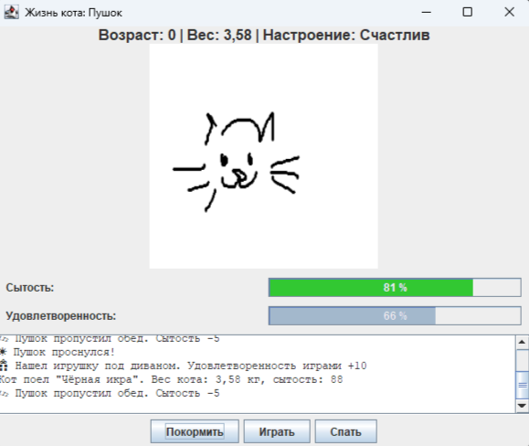

# 🐱 Жизнь кота

Графическая игра-тамагочи. Эмуляция тамагочи 80-х: вы заботитесь о коте — кормите его, играете с ним и следите за его состоянием. Кот растёт, худеет, голодает, устаёт от игр и, увы, может умереть, если за ним не следить.



## ✨ Возможности

- Создание кота с уникальным именем
- Просмотр состояния: возраст, вес, сытость, желание играть
- Кормление разными блюдами (у каждого — свой эффект на вес и сытость)
- Игры с котом с разными игрушками
- Сон: кот спит случайное количество часов, за которые проходит время
- Случайные события: кот может поймать мышь, пропустить обед, получить подарок или загрустить из-за дождя
- Автоматическое течение времени: кот худеет, голодает и устаёт от игр при каждом появлении меню
- Старение кота: каждые 20 «тиков» — плюс один год
- Настроение кота: счастлив, скучает, голоден или грустит — в зависимости от сытости и желания играть
- Смерть кота: от истощения, ожирения, голода или старости
- Отказы кота от еды и игр с объяснением причины
- Динамическая смена картинок в зависимости от состояния кота
- Лог событий прямо в окне игры

## 🎮 Управление

| Кнопка          | Действие                                  |
|-----------------|-------------------------------------------|
| **Покормить**   | Открывает меню выбора еды                 |
| **Играть**      | Открывает меню выбора игрушки             |
| **Спать**       | Кот спит случайное количество часов       |

Время в игре идёт автоматически (каждые 3 секунды). При смерти кота кнопки блокируются.

## 📋 Правила

- **Сытость** — значение от 0 до 100, где 0 — сильно хочется есть, 100 — полное насыщение.
- **Удовлетворённость играми** — значение от 0 до 100, где 0 — очень хочет играть, 100 — наигрался.
- Кот **отказывается от еды**, если сытость достигла 100.
- Кот **отказывается играть**, если:
  - он голоден (сытость ≤ 20),
  - он слишком сыт (сытость ≥ 100),
  - он уже наигрался (удовлетворённость = 100).
- Кот умирает, если:
  - вес < 1.0 кг (истощение),
  - вес > 15.0 кг (ожирение),
  - сытость ≤ 0 (голод),
  - возраст ≥ 15 лет (старость).

## 🍽️ Меню еды

| Блюдо                    | Вес      | Сытость |
|--------------------------|----------|---------|
| Рыба                     | +0.1 кг  | +20     |
| Консервированный тунец   | +0.3 кг  | +30     |
| Чёрная икра              | +0.5 кг  | +40     |

## 🧸 Игрушки

| Игрушка           | Удовлетворение |
|-------------------|----------------|
| Фантик            | +5             |
| Клубок ниток      | +10            |
| Игрушечная мышь   | +15            |

## 😸 Настроение

Настроение кота зависит от сытости и удовлетворённости играми:

| Сытость | Желание играть | Настроение |
|---------|----------------|------------|
| > 50    | > 50           | Счастлив   |
| > 50    | ≤ 50           | Скучает    |
| ≤ 50    | > 50           | Голоден    |
| ≤ 50    | ≤ 50           | Грустит    |

## 🎲 Случайные события

При каждом появлении меню с вероятностью 10% происходит случайное событие:

- 🐭 Кот поймал мышь: сытость +5, вес +0.05 кг
- 💤 Кот пропустил обед: сытость −5
- 🎁 Сосед подарил игрушку: удовлетворённость играми +10
- 🌧️ На улице дождь: удовлетворённость играми −5
  
## 🛠️ Технологии

- **Java 21**
- Только стандартная библиотека, без внешних зависимостей
- **JUnit 5** для юнит-тестов
- **Java Swing** для графического интерфейса
  
## 🧪 Тестирование

Проект покрыт юнит-тестами (JUnit 5), которые проверяют:
- Создание кота с параметрами по умолчанию
- Логику кормления (включая отказ при полной сытости и ограничение максимума)
- Логику игры (включая отказы при голоде, переедании и усталости)
- Смерть кота от истощения, ожирения, голода и старости
- Определение настроения по сытости и желанию играть
- Изменение веса и возраста

Для запуска тестов в IntelliJ IDEA: правой кнопкой по папке `src/test/java` → **Run 'All Tests'**.

## 🚀 Запуск

1. Склонируйте репозиторий:
   ```bash
   git clone https://github.com/your-username/life-of-cat.git
   Откройте проект в вашей IDE (IntelliJ IDEA, Eclipse и т.п.).

2. Запустите класс LifeOfCat (src/main/java/ru/pushok/LifeOfCat.java).

3. Или через командную строку:
```bash
  javac -d out src/main/java/ru/pushok/*.java
  java -cp out ru.pushok.LifeOfCat
```


### Что изменилось по сравнению со старой версией:

1. **Добавлены команда сна (`4`)** и случайные события в раздел «Возможности».
2. **Обновлены правила**: отказ от еды теперь при 100 (а не 50), отказ от игры при 100 (а не 90), добавлены условия смерти.
3. **Добавлен раздел про настроение** с таблицей.
4. **Добавлен раздел про случайные события**.
5. **Добавлен раздел про тестирование** (JUnit 5).
6. **Обновлена структура проекта** — добавлены `Mood.java` и папка `test`.
